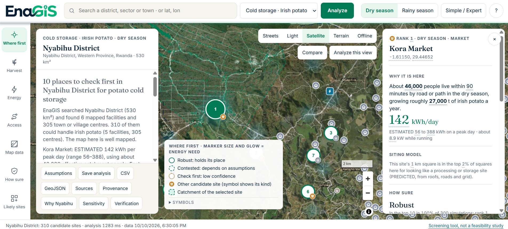

<p align="center"></p>

<p align="center">
<a href="https://github.com/Elie1Z/EnaGIS/actions"></a>
<a href="LICENSE"></a>
<a href="LICENSE-DATA.md"></a>


</p>

**EnaGIS tells productive-use-energy teams which agricultural storage sites to investigate
first, and how sure it is.** It is a screening shortlist for phone checks and site visits, not a
feasibility study. Submitted to OSEAS 2026, *Assessment and Mapping of Productive Uses of Energy
(Agriculture)*.

## In 30 seconds

**Nyabihu case study:** open [EnaGIS Live](live/index.html) and choose **Nyabihu · Irish potato cold storage**.
It opens offline on real, hashed inputs; Page Down steps through six preset views. See the
[assumption sheet](docs/hero-assumptions.md), [newer-data references](docs/hero-data-freshness.md) and
[verification kit](data/rwanda/hero/README.md). `make hero-repro` checks the frozen ranking;
`make live-siting` verifies the frozen siting experiment without retraining or overwriting it.
Desk checks and phone calls are recorded in the kit as they happen; today the count is zero.

**EnaGIS Live** is the main tool. It runs in the browser on open data gathered on the spot and is
set up for Rwanda: NISR district production for Irish potato and maize, four value chains (potato
cold storage, milk cooling, maize milling, maize drying), and a siting model tested on all 30
Rwandan districts under a protocol registered before it was run. It puts **73.1%** of documented collection
and processing points in the top 10% of their district, against 49.3% for counting buildings
(+23.9 points, 95% interval 13.4 to 34.4). See [phase4r-results](docs/phase4r-results.md). XGBoost, suggested by the
challenge brief, was tested against it under a protocol fixed in advance and did worse (−9.0 points, −15.1 to −3.3),
so the app keeps the logistic model. See [phase4x-results](docs/phase4x-results.md). The open data behind
it is listed in [Rwanda data](#rwanda-data).

EnaGIS started as a [Canadian pilot](#where-it-started-the-canadian-pilot), where ground truth exists, to
test the method before applying it in Rwanda.



## Repository map

| Folder | What is in it |
|---|---|
| [`live/`](live/README.md) | **EnaGIS Live, the main tool.** Static browser app; the analysis engine runs in a Web Worker (`live/js/engine.js`). `live/tools/` holds the Node scripts for the frozen Nyabihu case and its checks. |
| [`src/enagis/`](src/enagis/) | Python package for the Canadian pilot: ingestion, allocation, energy, siting experiment and verification. CLI: `python -m enagis`. |
| [`research/`](research/) | Registered research runs: XGBoost comparison (Phase 4X) and the Njombe footprint test (Phase 4N). |
| [`app/`](app/README.md) | Built offline app for the Canadian pilot. Generated by `scripts/build_mvp.py` from `web/mvp/`; do not edit by hand. |
| [`web/`](web/) | Front-end source for `app/` (`web/mvp/`), shared view model and assets. |
| [`demo/`](demo/README.md) | Archived Phase 5 demo, kept because its evidence files are hash-registered. |
| [`data/`](data/) | Rwanda inputs (`data/rwanda/`) and manual tables (`data/manual/`). Raw downloads are not committed. |
| [`configs/`](configs/) | Versioned scientific settings: scope, regions, scenarios, experiments, frozen-artifact hashes. |
| [`scripts/`](scripts/) | Build, release and check scripts called by the `Makefile`. |
| [`tests/`](tests/) | Python tests (`pytest`) and JavaScript tests for the live tool (`tests/live/`). |
| [`docs/`](docs/README.md) | Documentation. Start at [docs/README.md](docs/README.md). |

## EnaGIS Live: search any place

**[`live/`](live/README.md) is the working tool.** Open `live/index.html` and search a district
(for example "Musanze District, Rwanda"). In about a minute it:

1. gathers open data for that area:
   - OpenStreetMap facilities and settlements;
   - Overture Maps building footprints (OpenStreetMap, Google and Microsoft), roads, power lines and
     agricultural places;
   - WorldPop population;
   - Open-Meteo climate;
2. builds dry- and rainy-season road catchments;
3. estimates the electricity a value chain would need (potato cold storage, milk cooling, maize
   milling or maize drying), with ranges from 300 simulations;
4. ranks sites as Robust, Contested or Check first, and compares with a simpler straight-line
   method;
5. shows each site's distance to the mapped grid and the solar size that would cover one peak day;
6. scores every 1 km square with the siting model and lists unmapped look-alikes to check
   (PREDICTED);
7. answers with a ranked list, plain-language findings and one question to ask before visiting.

There are five map basemaps, seven lenses, a side-by-side compare view, and saved analyses that
replay offline. All 30 Rwandan districts have been run end to end:
[national screening](docs/rwanda-national-screening.md). Method: [docs/live-engine.md](docs/live-engine.md). Decisions:
[0012](docs/decisions/0012-live-analysis-engine.md) and [0013](docs/decisions/0013-open-data-stack.md). Live results are screening estimates from
open data and unapproved parameters; field verification n = 0.

## Rwanda data

Every value in EnaGIS Live carries its source, retrieval time and licence, in the app and in saved
analyses. No private data is used.

| Data | Source | Used for | Licence |
|---|---|---|---|
| District production, Irish potato and maize | NISR Seasonal Agricultural Survey 2024 (Season A area and yield tables, 2024 annual totals) | Harvest volume per district | Public statistics, attributed to NISR |
| District population | NISR 5th Population and Housing Census, 2022 (via citypopulation.de) | District context | Public statistics, attributed to NISR |
| Area boundaries | Nominatim (OpenStreetMap geocoder) | Study area | ODbL 1.0, © OpenStreetMap contributors |
| Facilities, markets, settlements | OpenStreetMap via Overpass | Sites to rank | ODbL 1.0, © OpenStreetMap contributors |
| Agricultural places | Overture Maps places, release `2026-09-23.1` | Extra documented facilities | CDLA-Permissive-2.0 |
| Buildings | Overture Maps buildings: OpenStreetMap, Google Open Buildings, Microsoft footprints | Settlement density, roof sizes, siting features | ODbL 1.0 (Google Open Buildings: CC BY 4.0 / ODbL) |
| Roads, paths and power lines | Overture Maps transportation and base (from OpenStreetMap) | Road catchments, distance to the mapped grid | ODbL 1.0 |
| Population grid | WorldPop 2020 | Population inside the study area | CC BY 4.0 |
| Climate | Open-Meteo ERA5 archive, 2024 | Cooling load (hottest-month temperature) | CC BY 4.0 |
| Offline basemap and place names | Natural Earth | World map without internet | Public domain |

Files and hashes: [data/rwanda/](data/rwanda/README.md) (district production and the siting training
table) and [data/rwanda/hero/](data/rwanda/hero/README.md) (the frozen Nyabihu inputs, with a per-file
manifest). Raw Overture tile archives are not redistributed. Licence obligations are in
[LICENSE-DATA.md](LICENSE-DATA.md); data vintages and newer releases are in
[hero-data-freshness](docs/hero-data-freshness.md).

## Where it started: the Canadian pilot

After harvest, grain sits in storage that needs electricity for aeration fans. Nobody publishes
which sites need the most power or which have enough. EnaGIS takes open registries and statistics
(no private data), estimates a technical energy requirement for each documented site, compares it
with documented supply, and produces a ranked top 10. Each site comes with its sources, an evidence
label on every number, and the one question to ask before a visit. Where evidence is missing it
says **UNKNOWN**, never zero.

The pilot covers 261 primary grain elevators in Alberta and Saskatchewan (AAFC 2024 registry).
We also ran a preregistered machine-learning siting experiment there. It **did not beat** a simple
production-only baseline, and we report that loss.

The pilot app is [`app/`](app/README.md); its datasets are in the [data catalogue](docs/data-catalogue.md).

## Quick start (3 commands)

Needs Python 3.12, [uv](https://docs.astral.sh/uv/) 0.12+, and network for the first install.
Node.js 22+ is optional (JavaScript tests and demo preflight).

```sh
git clone https://github.com/Elie1Z/EnaGIS.git && cd EnaGIS
uv sync --locked --cache-dir .uv-cache
uv run --offline --locked --cache-dir .uv-cache python -m pytest
```

Then open **`live/index.html`** (EnaGIS Live) or **`app/index.html`** (Canadian pilot) in Chrome,
Edge or Firefox. Both work offline, with no server. `make live-test hero-repro` runs the live tool's tests.
`make check` runs lint, tests and the smoke fixture; `make mvp verify-mvp` rebuilds and verifies
the app. Everything else is in [docs/reproducibility.md](docs/reproducibility.md).

**New to the code?** Open `live/index.html` and press **Nyabihu · Irish potato cold storage**; read
[live/README.md](live/README.md) (file map) and [docs/live-engine.md](docs/live-engine.md) (how the engine
works); run `make live-test hero-repro`; then pick a task from
[good first issues](docs/good-first-issues.md) and follow the [rules](CONTRIBUTING.md#rules).

## What is done, what is not

| Area | Status | Evidence |
|---|---|---|
| ML siting model, Rwanda (EnaGIS Live), registered protocol v1.1, all 30 districts held out in turn | Done; **verdict KEEP**: 73.1% vs 49.3% recall at top 10%, margin +23.9 [13.4, 34.4]; holds after a label audit | [phase4r-results](docs/phase4r-results.md) |
| XGBoost vs the Rwanda siting model (Phase 4X), protocol hashed before scoring | Done; **TESTED, NOT BETTER**: 64.2% vs 73.1%, difference −9.0 [−15.1, −3.3]; app keeps logistic | [phase4x-results](docs/phase4x-results.md) |
| Second site for the suggested tools: 7 regions scouted; footprint classifier on Njombe (Tanzania) grain mills | Done; no region has open sub-metre imagery over labelled facilities (no image detector possible); Njombe footprint classifier **KILL** (+1.6 [−0.3, 3.4]) | [second site](docs/second-site.md) |
| Canadian pilot: open registry: 340 records with source, date, licence, precision class (all P2) | Done | [data catalogue](docs/data-catalogue.md) |
| ML siting experiment, Canada, preregistered at Git tag `preregister-phase4-canada-v1.1` | Done; **verdict KILL**: full model 35.71% vs production-only 39.76% recall at top 20% | [validation](docs/validation.md) |
| Canadian pilot: shipping-point hindcast (52 groups) | Done; absolute volumes not validated | [validation](docs/validation.md) |
| Canadian pilot: energy requirement and top 10 | Temporary engineering scenario; parameters **not** human-approved; range UNKNOWN | [method](docs/method.md) |
| Energy *gap* | UNKNOWN for all sites: no open data on installed electrical capacity | [evidence ledger](docs/evidence-ledger.md) |
| Field verification | **Not done (n = 0)**; tooling tested on synthetic data | [limitations](docs/limitations.md) |
| Canadian pilot: transfer to a new region | Not evaluated; Manitoba hold-out untouched | [scope and transfer](docs/scope-and-transfer.md) |

## Documentation

Full index: [docs/README.md](docs/README.md).

| Start here | For |
|---|---|
| [Overview](docs/overview.md) | What EnaGIS is, who it is for, the decision it supports |
| [Method](docs/method.md) | One-page method plus links to the deep dives |
| [Validation](docs/validation.md) | Metrics, intervals, n, protocol, verdict, and what it does not show |
| [Limitations and non-claims](docs/limitations.md) | What we never claim |
| [Evidence ledger](docs/evidence-ledger.md) | What we know, estimated and do not know, and how to close each gap |
| [Rwanda data](#rwanda-data) · [Data catalogue](docs/data-catalogue.md) | Every dataset with source, date, licence and hash (catalogue: Canadian pilot) |
| [Scope and transfer](docs/scope-and-transfer.md) / [Scaling guide](docs/scaling.md) | Why Canada, and how to apply EnaGIS to a new country or crop |
| [Architecture](docs/architecture.md) · [Glossary](docs/glossary.md) | How the pieces fit; terms |
| [Reproducibility](docs/reproducibility.md) | Clean rebuild, checksums, runtime, hardware |
| [FAQ](docs/faq-for-judges.md) | Hard questions, honest answers |
| [Proof of work](docs/proof-of-work.md) | Counts and hashes taken from the repository |
| [Contributing](CONTRIBUTING.md) · [Good first issues](docs/good-first-issues.md) · [Help wanted: data](docs/help-wanted-data.md) | How to help |
| [Roadmap](docs/roadmap.md) · [Changelog](CHANGELOG.md) · [How we build](docs/development-process.md) | Plans, history, development process |
| [Proposals awaiting approval](docs/proposals/) | Scientific changes not yet adopted |
| [Project history](docs/project-history.md) | Phase-by-phase record |

## Licences and citation

Code is [MIT](LICENSE). Data keeps its source licence. Rwanda (EnaGIS Live): **ODbL 1.0** for
OpenStreetMap- and Overture-derived boundaries, facilities, buildings, roads and power;
CDLA-Permissive-2.0 for Overture places; CC BY 4.0 for WorldPop and Open-Meteo; NISR statistics
with attribution. Canadian pilot: Open Government Licence – Canada, Statistics Canada Open Licence
and ODbL 1.0 for OpenStreetMap-derived roads. See [LICENSE-DATA.md](LICENSE-DATA.md). Cite with [CITATION.cff](CITATION.cff).
